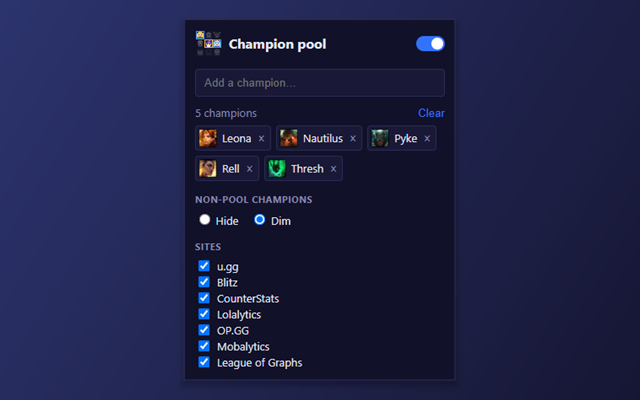

# Champion Pool Filter

Browser extension (Chrome / Edge / Firefox, Manifest V3) that hides champions outside your pool from counter lists on
LoL stats sites.

**[Install from the Chrome Web Store](https://chromewebstore.google.com/detail/champion-pool-filter/anhglmnblfcnbkfgihjniejjlhkbaknk)**
(works in Chrome and Edge). The Firefox version is in review on addons.mozilla.org and coming soon.



## Supported sites

| Site             | Pages with filtered lists                                                |
| ---------------- | ------------------------------------------------------------------------ |
| u.gg             | `/lol/champions/<champ>/counter`                                         |
| Blitz            | `/lol/champions/<champ>/counters`                                        |
| Lolalytics       | `/lol/<champ>/counters/`                                                 |
| CounterStats     | `/league-of-legends/<champ>`                                             |
| DPM.LOL          | `/champions/<Champ>/build` (matchups box), `/matchups` (opponent picker) |
| OP.GG            | `/lol/champions/<champ>/counters`, `/build` (counters box)               |
| Mobalytics       | `/lol/champions/<champ>/counters`, `/build` (weak/strong against boxes)  |
| League of Graphs | `/champions/counters/<champ>`, champion overview (counters box)          |

Every adapter targets the site's actual markup, worked out from saved copies of its pages, and reads the champion from a
link or a portrait's `alt` text. Synergy / duo-partner lists are never filtered, since they list allies.

## Install

**Chrome / Edge:** install it from the
[Chrome Web Store](https://chromewebstore.google.com/detail/champion-pool-filter/anhglmnblfcnbkfgihjniejjlhkbaknk), then
click the extension icon and add the champions you play.

### From source (Chrome / Edge)

1. Open `chrome://extensions` (or `edge://extensions`), enable **Developer mode**.
2. **Load unpacked** → select this folder.
3. Click the extension icon, add the champions you play.

### Firefox (142+)

- **Quick test:** `about:debugging#/runtime/this-firefox` → **Load Temporary Add-on…** → pick `manifest.json`. It is
  removed when Firefox restarts.
- **Permanent:** sign it as an unlisted add-on (free, automated):
  `npx web-ext sign --channel=unlisted --api-key=... --api-secret=...` (keys from
  https://addons.mozilla.org/developers/addon/api/key/), then open the produced `.xpi` in Firefox.
- If nothing gets filtered, check `about:addons` → the extension → **Permissions** and allow access to the stats sites
  and ddragon.leagueoflegends.com.

## Popup options

- **On/off switch** – toggles filtering globally.
- **Champion pool** – type to search (arrow keys + Enter, or click).
- **Hide / Dim** – remove non-pool champions entirely, or just fade them out (default: Dim).
- **Sites** – enable/disable per supported site.

Settings live in `chrome.storage.sync`; pages update live when you change them.

## Layout

```
src/core/namespace.js   shared global (content scripts can't use ES modules)
src/core/champions.js   name normalization + aliases, champion catalog from Riot Data Dragon
src/core/settings.js    settings storage
src/sites/registry.js   adapter registry + interface docs
src/sites/*.js          one adapter per site
src/content/filter.js   site-agnostic engine (applies filter, watches DOM / SPA navigation)
src/popup/              settings UI
icons/                  extension icons (16/32/48/128 px)
docs/                   README images (not packaged)
```

## Adding a new site

1. Save a counter page with its list fully loaded: scroll through it, then run this in the DevTools console (it saves
   the rendered page to Downloads, including content added by JavaScript that **Ctrl+S** may miss):
   ```js
   const a = document.createElement("a");
   a.href = URL.createObjectURL(new Blob([document.documentElement.outerHTML], { type: "text/html" }));
   a.download = "page.html";
   a.click();
   ```
   For lists that only exist while a dropdown is open, wrap it in `setTimeout(() => { ... }, 5000)` and open the
   dropdown during the delay.
2. In the saved page, find one row and where the champion can be read from (a link like `/vs-<champ>` is best; an
   `` works too).
3. Create `src/sites/<site>.js` calling `CPF.sites.register({ id, name, matches, findRows })` (see the interface in
   `src/sites/registry.js`). `findRows` just returns `{ element, champion }` pairs — the engine handles everything else.
   `CPF.sites.pages()` and `CPF.sites.linkRows()` cover the common cases; see the existing adapters.
4. In `manifest.json`, add the site's domain to `host_permissions` and `content_scripts.matches` (the whole domain, not
   just counter pages, so navigating into a counter page inside the site is caught), and the file to `js` (after
   `registry.js`, before `filter.js`). The popup loads the same list, so the site appears in its Sites list.
   `npm run lint` fails if any of these is missing or they disagree.
5. If the site spells a champion unusually, add an entry to `ALIASES` in `src/core/champions.js`.

## Development

Requires Node.js 22+. Run `npm install` once.

- `npm run lint` — runs all checks (the same ones GitHub Actions runs on every push and pull request):
  - `lint:js` — ESLint (strict rules + `eslint-plugin-unicorn`), zero warnings allowed
  - `lint:format` — Prettier formatting check (120-column lines, including Markdown)
  - `lint:ext` — `web-ext lint`, Mozilla's validator for the manifest and extension code
- `npm run fix` — auto-fixes what ESLint can and reformats everything with Prettier.
